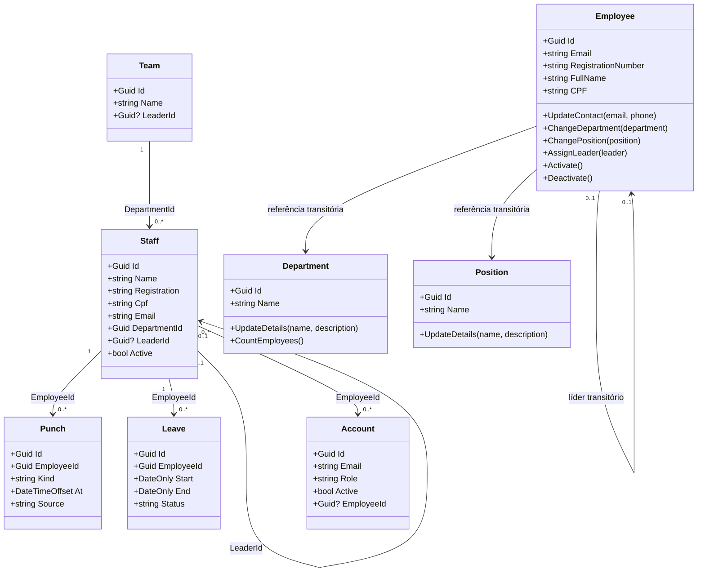

# Modelo de classes observado

O diagrama diferencia os registros persistidos (`Operations`) do objeto de domínio transitório (`Employee`). As relações de persistência são atualmente armazenadas por identificadores e consultadas pelo `DataStore`; não são associações de navegação EF entre essas classes.

`Staff`, `Team`, `Punch`, `Leave` e `Account` são os tipos de `Operations/Models.cs` mapeados no `TimeIdDbContext`. `Employee`, `Department` e `Position` vêm de `Dominios/Employee/`; `EmployeeService` os utiliza para aplicar algumas operações antes de copiar os valores ao registro `Staff`. A identidade persistida continua sendo `Staff`.

## Limites e discrepâncias

- Multiplicidades do diagrama descrevem as relações pretendidas pelos identificadores e consultas; o banco não declara chaves estrangeiras para essas ligações.
- Um funcionário pode estar vinculado a zero ou mais contas segundo o formato e o mapeamento atuais; a aplicação trabalha normalmente com uma conta vinculada, mas não há restrição única no banco para impor esse máximo.
- O histórico `Punch` e os pedidos `Leave` não são objetos compostos dentro de `Staff`; são registros independentes associados por `EmployeeId`.
- `Leave.Status` usa texto validado pelo controller, não uma máquina de estados encapsulada na classe.
- `Employee` tem alguns métodos de comportamento, mas propriedades centrais ainda têm setters públicos e as regras de unicidade e ciclos consultam o conjunto no serviço.
- `TimeRecord`, `Vacation` e outras classes antigas em `Dominios/` não devem ser confundidas com os tipos persistidos usados pelos fluxos atuais.
- Não há contrato polimórfico de repositório em uso demonstrado por este modelo.
